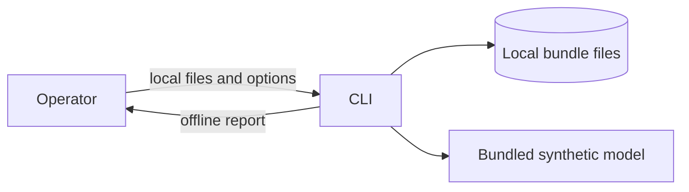
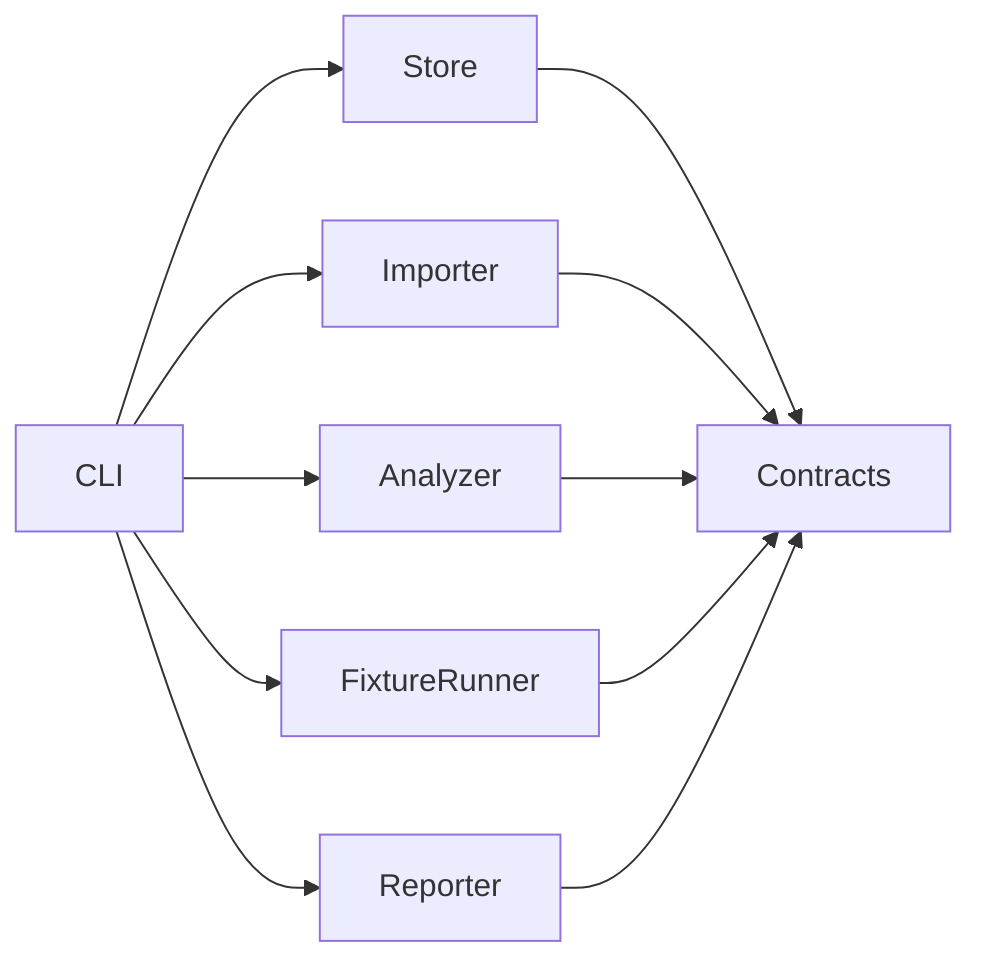

# Solution Design Document

All 55 template headings, including bracketed example/flow labels, are deliberately
retained verbatim. Their bodies name the actual examples and action and are filled;
no unresolved body clarification markers remain. ADRs are still review proposals.

## Validation Checklist

### CRITICAL GATES (Must Pass)

- [x] Required sections populated; template heading sequence preserved.
- [x] No unresolved clarification markers; open decisions recorded as ADRs.
- [x] Architecture pattern and rationale stated.
- [ ] All architecture decisions confirmed by user: pending documentation PR review.
- [x] Proposed interfaces specified or linked; implementation schemas remain future work.

### QUALITY CHECKS (Should Pass)

- [x] Context relevance, discovered commands, component/directory mapping documented.
- [x] Constraints, requirements, interfaces, errors, and test targets connected.
- [x] Naming and responsibility boundaries reviewed for overlap.
- [ ] Runtime/version and adapter compatibility spike completed before implementation.
- [ ] Product tests executed: no product runtime exists.

## Constraints

CON-1: Agreed scope is an offline, independent product with zero new initial paid
hosting/inference; use local synthetic fixtures, not live Stripe or remote replay.
CON-2: Imported evidence is inert and incomplete; delivery, execution, and business
effect must remain distinct. Event creation time is not arrival or causal order.
CON-3: Source/docs live on the pendrive; Mac CPU/RAM execute work. No dedicated
project worker/server is provisioned. See [operations](../../operations.md).
CON-4: This PR is documentation only. Proposed TypeScript/Node, file storage,
dependency/version choices, and fixture policy require owner approval.

## Implementation Context

### Required Context Sources

#### Documentation Context

| Source | Relevance | Why |
| --- | --- | --- |
| [Issue #4](https://github.com/Himanshu-singh04/hooktrace/issues/4) | CRITICAL | Exact planning acceptance A1–A7; approval workflow owned by coordinator |
| [Product](../../product.md), [contract](../../evidence-contract.md) | CRITICAL | HT requirements and authoritative record semantics |
| [AGENTS](../../../AGENTS.md), [contributing](../../../CONTRIBUTING.md) | HIGH | Repository boundaries and actual checks |
| [Development](../../development.md), [foundation](../../foundation.md) | HIGH | Delivery policy and current implementation status |
| [Testing](../../testing.md), [roadmap](../../roadmap.md), [operations](../../operations.md) | HIGH | Verification, dependencies, and actual execution constraints |
| [Stripe webhooks](https://docs.stripe.com/webhooks) | HIGH | Acknowledgments, retries, duplicate events, ordering, signature requirements |
| [Stripe Event object](https://docs.stripe.com/api/events/object) | HIGH | Event identity, creation time, API-version and account/context fields |
| [Subscription webhooks](https://docs.stripe.com/billing/subscriptions/webhooks) | HIGH | Subscription event meanings and limits of invoice/access inference |
| Local `architecture-design-rsmdt/template.md` and `validation.md` | HIGH | Required section sequence and completeness checks; read from `/Users/himanshusingh/.config/opencode/skills/architecture-design-rsmdt/` |

Primary Stripe pages read 2026-11-18. They describe provider behavior, not the
completeness or authenticity of a user's export. They do not prove incident cause.
Current docs cover thin and snapshot events; this MVP deliberately supports a narrow
snapshot subset. Pin supported payload versions using reviewed fixtures; do not treat
the docs' latest examples as a runtime/version decision. No Stripe API calls were made.

#### Code Context

`scripts/check_repository.py` (HIGH) validates tracked text and local Markdown file
links; new untracked docs require an extra check. `scripts/test_*.py` (HIGH) tests
repository policy, not product behavior. README (HIGH) has no application commands.
No application manifest, SDK, database, or reusable runtime module exists.

#### External APIs (if applicable)

N/A for runtime integration. Stripe documentation informs offline interpretation;
there is no API client, webhook listener, authentication token, or retrieval fallback.

### Implementation Boundaries

Preserve repository policy and source evidence. This design can add documentation;
later approved tasks may add schemas, modules, and synthetic fixtures. Customer data,
credentials, production endpoints, and imported code execution are outside scope.
Approval-policy edits to AGENTS/development are handled by the coordinator.

### External Interfaces

#### System Context Diagram



#### Interface Specifications

Inbound: local manifest/raw files per [evidence contract](../../evidence-contract.md),
plus a packaged fixture ID, permutation, and seed. Outbound: frozen/normalized files,
`Report`, Markdown rendering, `Diagnostic`, and separate run logs. Local OS file
permissions provide access control; there is no HTTP authentication surface.
Future CLI grammar (unimplemented): `import --manifest PATH --out DIR`,
`analyze --bundle DIR --out DIR`, and
`reproduce --fixture subscription-ordering-v1 --variant buggy|fixed --out DIR [--permutation TOKENS] [--seed N]`.
Fixture, variant, and output are required. Proposed `--permutation` is a comma-separated
list of 2–8 exact U/D tokens, both present, repeats allowed; default `D,U`. No whitespace,
empty tokens, file references, or arbitrary event IDs/payloads are accepted. Proposed
`--seed` is decimal digits only in range 0–4294967295; default 0. Record resolved values
in FixtureRun even when options are omitted. This fixture has no random behavior;
seed is retained for replay metadata, not used to change input order or timestamps.
Reject unknown/repeated options, unsupported fixtures/variants, bad permutations/seeds,
and arbitrary positional inputs before execution. No URL, shell, handler path, plugin,
imported bundle, or remote target option is accepted. These are proposed interfaces.
Proposed exit codes: 0 complete; 2 input/contract/unsupported-platform error; 3 local I/O failure;
4 fixture assertion failure/incomplete run; 1 unexpected internal error.
Analysis gaps are valid report content, not command failures.

### Cross-Component Boundaries (if applicable)

One process, one release, no distributed ownership. CLI orchestrates; Store owns file
I/O; Importer validates/normalizes; Analyzer owns links/rules; FixtureRunner executes
only packaged synthetic logic; Reporter renders evidence. None may duplicate another's
inference responsibility. Versioned file contracts are public; internal functions are
private. Breaking schemas get a new major version, never silent rewriting.

### Project Commands

Only these checks currently exist, from CONTRIBUTING.md:

```sh
python3 scripts/check_repository.py
python3 -m unittest discover -s scripts -p 'test_*.py'
actionlint -shellcheck= -pyflakes=
git diff --check
```

Install/dev/build/migrate/application commands: N/A until an approved runtime task.

## Solution Strategy

Propose a modular monolith CLI with pure normalization/analysis/rendering functions
and a small filesystem shell. Fixed local inputs support auditable repeatability;
no database server, queue, hosted UI, or inference service is needed for the first bug.
TypeScript fits JSON contracts and a Node handler fixture, but an exact supported
runtime and packaging approach must be checked before choosing dependencies.
Separate observations from hypotheses, and production evidence from model output.

## Building Block View

### Components



### Directory Map

All paths below are proposed, not existing modules:

| Component | Proposed path | Responsibility / requirements |
| --- | --- | --- |
| CLI | `src/cli/` | Options, limits, orchestration, exit codes; HT-08–10 |
| Store | `src/store/` | Frozen bytes, hashes, atomic publication; HT-01–02,09 |
| Contracts | `src/contracts/`, `schemas/` | Schema validation/types, no business inference; HT-01 |
| Importer | `src/import/` | Explicit source mapping and version-aware extraction; HT-01,05,08 |
| Analyzer | `src/analyze/` | Correlations, partial orders, findings; HT-03–05 |
| FixtureRunner | `src/fixture/`, `fixtures/subscription-ordering/` | Reset/read-back model execution; HT-06,08 |
| Reporter | `src/report/` | Deterministic JSON/Markdown and citations; HT-07 |

Future tests live in `tests/`; later RAG/agent code needs a new scoped design (HT-11).

### Interface Specifications

#### Interface Documentation References

[Evidence contract](../../evidence-contract.md) (CRITICAL) defines manifest, scope,
normalized records, links/orders, findings, fixture runs, reports, and diagnostics.
[Testing](../../testing.md) (HIGH) provides executable-contract acceptance scenarios.

#### Data Storage Changes

N/A for SQL/database migrations. Propose a write-once bundle containing `raw/`,
`input-manifest.json`, `frozen-manifest.json`, `evidence.json`, and report artifacts.
Derived outputs use new directories and reference parent hashes. CLI writes a sibling
temporary directory, flushes files, then renames on the same filesystem; never publishes
a half-built bundle. No concurrent writes to one output; fail on existing destination.
Power-loss durability depends on filesystem behavior, not merely rename success.
Store pins the input root and traverses each component with descriptor-relative,
no-follow opens; it validates and freezes from the same file descriptor, including
the manifest. No path-check/reopen fallback is permitted. B01 gates supported runtime/
platform selection on demonstrated parent/leaf-swap resistance and descriptor cleanup;
ordinary Node path APIs alone are not assumed sufficient. Unsupported platforms fail closed.

#### Internal API Changes

No HTTP endpoints. Proposed in-process contracts:
`freeze(manifestRelativePath, pinnedInputRoot) -> FrozenSources`, `normalize(FrozenSources) -> Evidence`,
`analyze(Evidence, scopes, rulesVersion) -> {links, orders, findings}`,
`runFixture(fixtureId, variant, permutation, seed) -> FixtureRun`,
`render(Report, citationIndex) -> {jsonBytes, markdownBytes}`,
`publish(outputDir, artifacts) -> ArtifactHashes`. Each returns typed diagnostics on
failure; filesystem handles remain inside Store except the isolated fixture store.
`FrozenSources` is the validated Manifest plus source-ID-to-frozen-byte mapping;
`ArtifactHashes` maps generated relative output paths to SHA-256. No hidden network I/O.
Store acquires the pinned root and manifest via the contract's no-follow descriptor
procedure; callers never supply a path-validated manifest for an unsafe later reopen.
CLI resolves permutation/seed defaults before calling runFixture; the internal function
requires all four arguments and revalidates the same fixture/variant/token/length/seed limits.
Direct callers cannot bypass the allowlist or supply arbitrary exported events.

#### Application Data Models

Use the contract verbatim; do not invent a second event or report shape. Event,
Attempt, Handler, and Snapshot are observations, not a unified success record.
Source-local input row labels/qualified refs are separate from derived IDs. Normalize
in two passes: assign IDs including stable Source.id, then resolve/rewrite and validate
references. Byte-identical separately declared exports keep separate origins/IDs.
Producer and per-identifier namespaces carry evidence refs and source-claim limitations;
unknown namespace cannot support explicit local correlations. Link records retain
competing targets; Order records express only imported observed-arrival sequences.
Finding records cite evidence and limitations. FixtureRun has a separate namespace,
explicit initial state/handler hashes, its own permutation, and read-back assertions.
Snapshots use the closed `hooktrace.subscription-state/1` field/type allowlist; values
keys and unique absentFields are disjoint. Reject inverted known coverage endpoints.
FixtureRunner derives assertion results from exact typed expected/read-back comparisons;
unavailable evidence makes the run incomplete. Publication validates these invariants,
including consistency with the cited snapshot/fixture, without trusting stored pass flags.

#### Integration Points

CLI passes immutable values between modules; Store supplies frozen input and publishes
outputs. Analyzer never calls FixtureRunner. Reporter never strengthens confidence or
reruns rules. FixtureRunner cannot consume exported event payloads, only a packaged
fixture allowlist. Stripe integration is file interpretation only; remote systems N/A.

### Implementation Examples

#### Example: [Complex Business Logic Name]

Example name: evidence-bounded correlation. Given a 200 attempt for event E and two
handler observations carrying E but no attempt ID, retain both candidate executions.
Report “delivery acknowledged; attempt-to-execution association ambiguous.” With no
persisted read, business effect remains unknown even if one log says `write_claimed`.
An explicit event ID cannot collapse several delivery attempts into one execution.

#### Example: [Integration Pattern Name]

Example name: isolated ordering reproduction. The bundled model has subscription S,
an `updated(active)` event U and terminal `deleted(canceled)` event D. Its declared
business rule is “once canceled, this subscription ID cannot grant access again.”
Buggy handler replaces state from every received snapshot. Permutation [D,U] wrongly
restores access; [U,D] does not. Fixed handler uses a durable cancellation tombstone
and event-ID deduplication in the same fixture-store transaction as state mutation.
It ignores U after D for this model. Reset restores the same empty initial state;
close/reopen the store before assertions to verify persisted local effect.
This terminal-state rule is specific to the scenario, not a universal Stripe fix;
the model's order is supplied explicitly and never inferred from `created`.

#### Test Examples as Interface Documentation

T03 expects 200 + no handler observations => a gap, no “handler failed” finding.
T06 expects buggy [D,U] => final `access=true` and failed expected-false assertion;
fixed [D,U] and [U,D] => persisted `access=false`, with duplicate inputs idempotent.
Both outcomes carry `modeled_scenario_not_production_cause` in JSON and Markdown.

## Runtime View

### Primary Flow

#### Primary Flow: [Main User Action]

Main action: inspect exports and demonstrate a local modeled failure.
1. CLI validates limits/options; Store freezes declared local bytes and verifies hashes.
2. Importer validates schema/scope, assigns source-qualified observation IDs, then
   resolves raw row refs in a second pass with type/boundary/cycle checks. Validate
   snapshot allowlists/presence consistency and coverage endpoints before publication.
3. Analyzer builds compatible links/partial orders and evidence-bounded findings.
4. Optional FixtureRunner starts a fresh synthetic store and runs resolved, bounded
   permutation/seed inputs; imported orders never contain synthetic nodes.
5. Reporter serializes findings and separate model results; Store publishes atomically.
6. Operator reviews unknowns/citations before sharing; no production mutation occurs.

### Error Handling

Contract failures and missing refs => located diagnostics, no partial report.
Unsupported provider version/type => retained context and interpretation limitation.
Conflicting identities => conflict finding, no merged assertion. Limit exceeded =>
bounded failure with counts; no silent truncation. Disk full/removed volume/permission
failure => `IO_FAILED`, preserve raw sources, leave clearly incomplete temp directory.
Unavailable secure acquisition primitives => `PLATFORM_UNSUPPORTED`, with no weaker
fallback. Symlink substitution/type failure => input rejection; changed captured bytes
or a declared hash mismatch => no published bundle. Invalid snapshot/coverage fields
=> `INPUT_INVALID`, with located diagnostics that omit rejected values.
Fixture timeout/read-back failure => incomplete model result. Unexpected failures =>
redacted `INTERNAL_ERROR`; logs outside reports. Network failure is N/A: no network path.

### Complex Logic (if applicable)

Partition by evidenced scope; index provider event IDs separately from local identifiers.
Local request/execution/transaction/store/stream matches require evidenced namespace
compatibility, not equal strings or a shared source alone. Namespace metadata remains
a source assertion, never authenticated application identity or causal proof.
Resolve direct compatible refs first; retain indirect candidates and conflicts. Rules
use observations without converting log absence into a negative fact. Group duplicate
receipts while preserving distinct rows; reject cyclic explicit retry relationships.
Build partial orders only from arrival indices within a stream. Never enumerate all
permutations of customer input; the packaged fixture uses a small declared test set.
Suggested implementation is O(n + k) indexing/links, with an explicit candidate cap;
if exceeded, fail with `LIMIT_EXCEEDED` rather than suppress ambiguity.

## Deployment View

### Single Application Deployment

Local Mac process initially; package/runtime support must be pinned in B01/B06.
Configuration: input/output directories, bounded fixture ID/permutation, deterministic
seed, documented limits. No Stripe credentials, model keys, hosted database, or paid
service required. Package/build downloads may need internet during installation;
installed product investigation/demo must work offline. Targets are in testing.

### Multi-Component Coordination (if applicable)

N/A: one package and process. Pin tool/schema/fixture versions together; rollback
selects a prior package and new output directory, preserving existing bundles.

## Cross-Cutting Concepts

### Pattern Documentation

Evidence preservation/correlation/versioning patterns: [contract](../../evidence-contract.md)
(CRITICAL). Review/attribution patterns: [development](../../development.md) (HIGH).
No existing application framework pattern is imposed on this foundation-only repo.

### User Interface & UX (if applicable)

Web/UI design system N/A. CLI output is plain text with counts, file locations,
unknowns, and actionable diagnostic codes. Color must be optional, never semantic.
Markdown headings/tables and escaped text should remain readable in a terminal.

#### UI Visualization Guide

N/A for screens. Proposed report reading order: scope and limits → source inventory →
observed delivery/handler/state → ambiguous links/gaps → modeled fixture → next checks.

### System-Wide Patterns

Never log full payloads or inherit credentials into future execution adapters. Local
file access uses least-needed permissions; raw evidence is not automatically encrypted.
Bound byte count, nesting, records, candidates, runtime, and report size. English text
and UTC timestamps initially; locale-independent deterministic serialization. Stable
source refs serve auditing, not distributed tracing. No telemetry or background jobs.

### Multi-Component Patterns (if applicable)

Distributed transactions, service discovery, circuit breakers, and queues: N/A.
Internal modules share Contracts only; CLI is the composition root. No dependency
cycles or imports from analysis into filesystem/fixture execution modules.

## Architecture Decisions

All implementation-impacting decisions below are proposals; none claims owner confirmation.

- [ ] ADR-1: TypeScript/Node modular CLI rather than Python CLI or hosted service.
  Rationale: typed JSON and handler familiarity; trade-off: runtime/toolchain packaging.
  Exact supported Node/TypeScript versions, package manager, and test tooling: B01.
  User confirmed: **Pending**.
- [ ] ADR-2: Frozen file bundles plus versioned JSON rather than a database.
  Rationale: inspectability/reproduction; trade-off: bounded dataset scale and explicit
  publication/recovery. Canonicalization/schema-library and descriptor-relative file
  acquisition feasibility (including any native helper): B01. User confirmed: **Pending**.
- [ ] ADR-3: Narrow snapshot adapter and conservative deterministic rules.
  Rationale: source-level traceability; trade-off: unsupported versions/types stay
  uninterpreted. Exact payload-version support matrix: B01. User confirmed: **Pending**.
- [ ] ADR-4: Only a packaged terminal-cancellation ordering fixture in MVP.
  Rationale: demonstrable local effect without executing imports; trade-off: limited
  production fidelity. Local transactional fixture-store choice: B01/B04.
  Future trusted adapters require real OS-enforced network/filesystem restriction;
  spawning a child process is not a sandbox. User confirmed: **Pending**.
- [ ] ADR-5: Optional cited retrieval/explanations and bounded tools after MVP.
  Rationale: evidence must work independently; trade-off: less flexible narrative.
  Model/license/hardware and enforcement experiments precede implementation.
  User confirmed: **Pending**.

## Quality Requirements

Proposed, not measured: Q1 identical canonical output across ten repeated runs;
Q2 10,000 records/50 MiB analyzed in ≤10 s and ≤512 MiB peak RSS on the observed
Mac; Q3 at least two of three pilot engineers complete the synthetic workflow and
correctly distinguish unknown from failed in ≤15 minutes after dependency installation;
Q4 zero outbound product traffic or imported code execution in adversarial tests;
Q5 interrupted writes never publish valid-looking partial reports. See T07/T09/T10/T08
in [testing](../../testing.md) for measurement protocols and caps.
Q3 belongs to B07 after B06. B06 verifies developer-run installation/demo and Q1/Q2/Q4/Q5;
pilot evidence is not a prerequisite for producing the package used in those pilots.

## Acceptance Criteria

- [ ] WHEN a supported bundle is imported, THE SYSTEM SHALL preserve hashes and
  source locations or return a located error (HT-01–02; T01–02).
- [ ] WHILE handler/state evidence is unavailable, THE SYSTEM SHALL retain unknowns
  independently of delivery acknowledgment (HT-03; T03).
- [ ] IF correlations conflict or multiple targets exist, THEN THE SYSTEM SHALL
  expose ambiguity without inferred ordering or cross-scope joins (HT-04–05; T04–05).
- [ ] WHEN the bundled fixture runs, THE SYSTEM SHALL reset state and demonstrate
  buggy/fixed persisted effects under the declared order (HT-06; T06).
- [ ] THE SYSTEM SHALL produce offline cited reports with model limitations and
  deterministic records, never execute imported code or contact Stripe (HT-07–08; T07–08).
- [ ] WHEN input limits or local I/O fail, THE SYSTEM SHALL fail boundedly and
  preserve inputs; installed demo SHALL work without paid services (HT-09–10; T09–10).
- [ ] WHERE later AI explanations are enabled, THE SYSTEM SHALL preserve authoritative
  findings and label cited hypotheses separately (HT-11; T11; later scope).

## Risks and Technical Debt

### Known Technical Issues

No product defects have been measured because no product exists. Export availability,
clock quality, version compatibility, and operator mappings may constrain usefulness.
Synthetic reproduction fidelity and customer demand remain unvalidated.

### Technical Debt

Proposed deliberate limits: file-sized analysis, one provider subset, no automatic
migrations, no customer handlers. Expand only after pilot evidence; do not build
distributed infrastructure to address unmeasured scale.

### Implementation Gotchas

`pending_webhooks=0` is not application completion; event `request.id` identifies a
triggering API request, not necessarily webhook delivery. Do not conflate them.
Distinct events may share `created`; manual and automatic delivery retries can coexist.
API-version-specific field paths and nullable account/context require explicit mapping.
A snapshot timestamp does not establish causality or a globally synchronized clock.

## Glossary

### Domain Terms

Delivery: one transport attempt. Handler observation: instrumentation of execution.
Business effect: observed persisted application state, subject to capture limits.
Modeled scenario: a deliberately isolated executable hypothesis, not incident proof.

### Technical Terms

Frozen bundle: exact source bytes plus hashed provenance. Partial order: only evidenced
relative sequence, not a total timeline. Canonical JSON: deterministic derived encoding.

### API/Interface Terms

Snapshot event: exported event with embedded object data. Thin event: notification
requiring additional context, unsupported for MVP analysis. Scope: evidenced account,
environment, and context boundary. Explicit link: direct unique observed association,
not authenticated provenance or causal proof.
